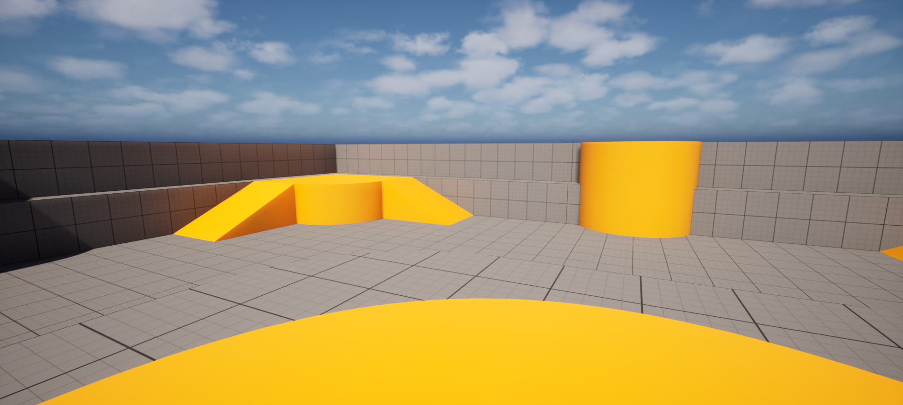
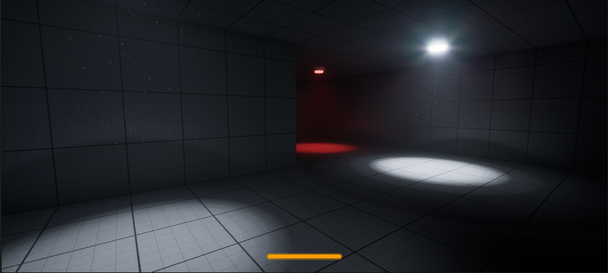
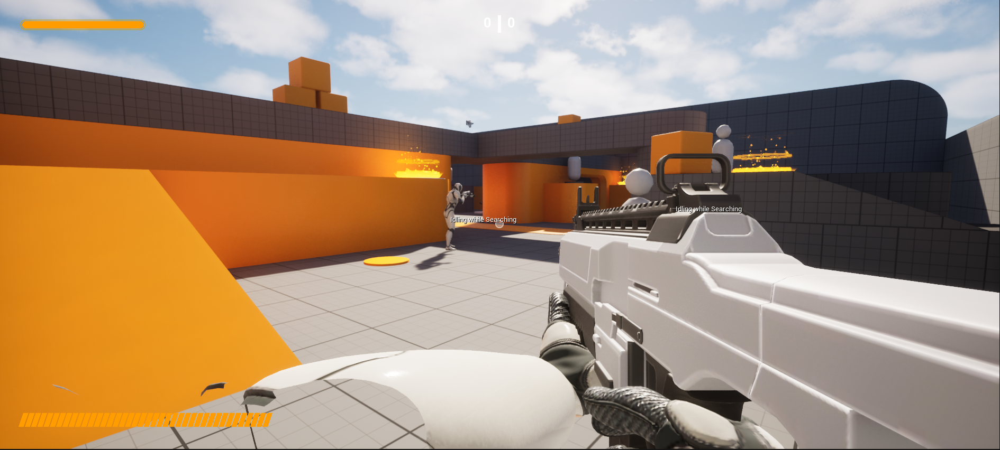

# first-person

The engine's First Person template, playable as it comes with keyboard and mouse, gamepad or touch: its character with first person arms and camera, camera manager, game mode and player controller are Rust classes, and their Blueprint children keep the meshes, animations and input assets.

```bash
rusteal new MyGame --template first-person
```

From `TP_FirstPerson`, the engine template it is made of.

## Playing it

Open the project and press **Play**: WASD / left stick move, mouse / right stick look, Space / A jump.



## Its classes

The Rust classes are in `Rust/<crate>/src/`; their Blueprint children, under the engine template's names, are in `Content/`.

| Class | Parent | File |
|---|---|---|
| `FirstPersonCameraManager` | `PlayerCameraManager` | `src/camera_manager.rs` |
| `FirstPersonCharacter` | `Character` | `src/character.rs` |
| `FirstPersonGameMode` | `GameModeBase` | `src/game_mode.rs` |
| `FirstPersonPlayerController` | `PlayerController` | `src/player_controller.rs` |

## Variants

Each variant is a project of its own: the template plus the variant, opening on the variant's level.

### horror

A dark level explored with a flashlight, and a sprint that runs on stamina, its meter on screen.

```bash
rusteal new MyGame --template first-person --variant horror
```

It opens `/Game/Variant_Horror/Lvl_Horror`. To play: WASD / left stick move, mouse / right stick look, Space / A jump, hold Shift / LB sprint.



Its own classes, next to the template's, in a module named after it:

| Class | Parent | File |
|---|---|---|
| `HorrorCharacter` | `FirstPersonCharacter` | `src/horror/character.rs` |
| `HorrorGameMode` | `GameModeBase` | `src/horror/game_mode.rs` |
| `HorrorPlayerController` | `PlayerController` | `src/horror/player_controller.rs` |
| `HorrorUI` | `UserWidget` | `src/horror/ui.rs` |

### shooter

An arena shooter: weapon pickups described by a data table, projectiles and grenades, team scores, and NPCs run by a StateTree that sense their enemies, snipe and shoot.

```bash
rusteal new MyGame --template first-person --variant shooter
```

It opens `/Game/Variant_Shooter/Lvl_Shooter`. To play: WASD / left stick move, mouse / right stick look, Space / A jump, left click / RT shoot, Left Shift / Y switch weapons.



Its own classes, next to the template's, in a module named after it:

| Class | Parent | File |
|---|---|---|
| `ShooterAIController` | `AIController` | `src/shooter/ai_controller.rs` |
| `ShooterCharacter` | `FirstPersonCharacter` | `src/shooter/character.rs` |
| `EnvQueryContextTarget` | `EnvQueryContext_BlueprintBase` | `src/shooter/env_query.rs` |
| `ShooterGameMode` | `GameModeBase` | `src/shooter/game_mode.rs` |
| `ShooterNPC` | `FirstPersonCharacter` | `src/shooter/npc.rs` |
| `ShooterNPCSpawner` | `Actor` | `src/shooter/npc_spawner.rs` |
| `ShooterPickup` | `Actor` | `src/shooter/pickup.rs` |
| `WeaponTableRow` | a struct | `src/shooter/pickup.rs` |
| `ShooterPlayerController` | `PlayerController` | `src/shooter/player_controller.rs` |
| `ShooterProjectile` | `Actor` | `src/shooter/projectile.rs` |
| `StateTreeLineOfSightToTargetCondition` | `StateTreeConditionBlueprintBase` | `src/shooter/state_tree.rs` |
| `StateTreeFaceActorTask` | `StateTreeTaskBlueprintBase` | `src/shooter/state_tree.rs` |
| `StateTreeFaceLocationTask` | `StateTreeTaskBlueprintBase` | `src/shooter/state_tree.rs` |
| `StateTreeSetRandomFloatTask` | `StateTreeTaskBlueprintBase` | `src/shooter/state_tree.rs` |
| `StateTreeShootAtTargetTask` | `StateTreeTaskBlueprintBase` | `src/shooter/state_tree.rs` |
| `StateTreeSenseEnemiesTask` | `StateTreeTaskBlueprintBase` | `src/shooter/state_tree.rs` |
| `ShooterUI` | `UserWidget` | `src/shooter/ui.rs` |
| `ShooterBulletCounterUI` | `UserWidget` | `src/shooter/ui.rs` |
| `ShooterWeapon` | `Actor` | `src/shooter/weapon.rs` |

Recipes taken from it: [Character movement and input](../recipes/input.md), [Cameras](../recipes/cameras.md), [Projectiles and weapons](../recipes/projectiles.md).
