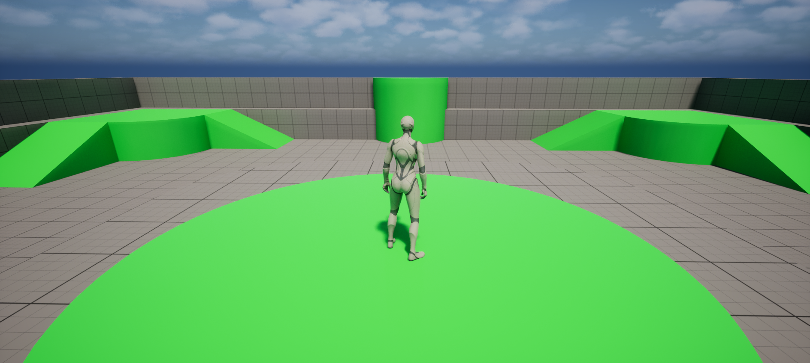
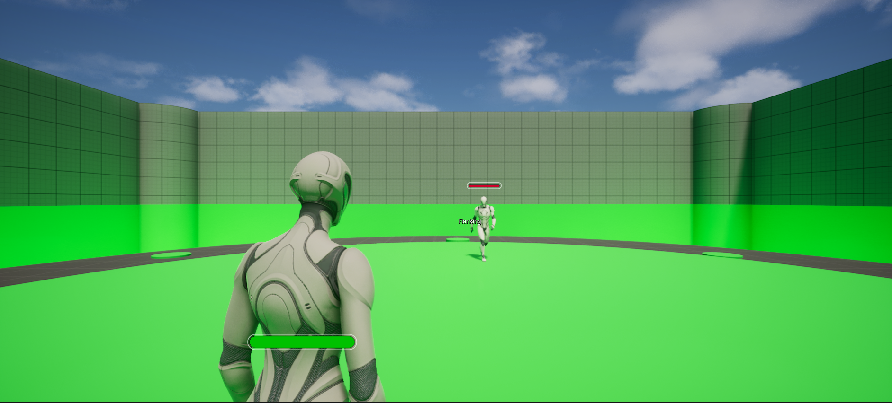
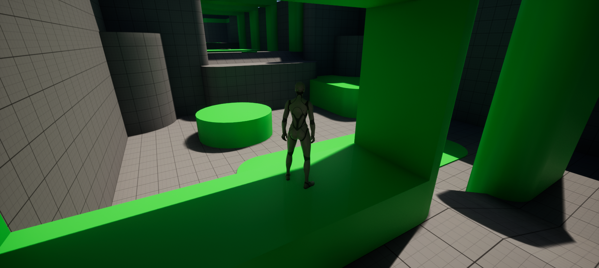
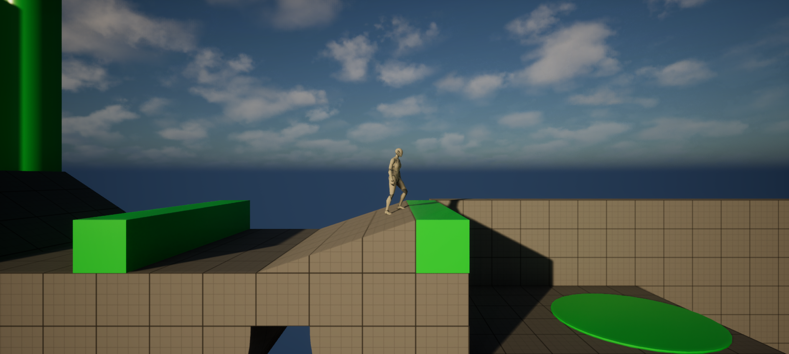

# third-person

The engine's Third Person template, playable as it comes with keyboard and mouse, gamepad or touch: its character with its spring arm camera, game mode and player controller are Rust classes.

```bash
rusteal new MyGame --template third-person
```

From `TP_ThirdPerson`, the engine template it is made of.

## Playing it

Open the project and press **Play**: WASD / left stick move, mouse / right stick look, Space / A jump.



## Its classes

The Rust classes are in `Rust/<crate>/src/`; their Blueprint children, under the engine template's names, are in `Content/`.

| Class | Parent | File |
|---|---|---|
| `ThirdPersonCharacter` | `Character` | `src/character.rs` |
| `ThirdPersonGameMode` | `GameModeBase` | `src/game_mode.rs` |
| `ThirdPersonPlayerController` | `PlayerController` | `src/player_controller.rs` |

## Variants

Each variant is a project of its own: the template plus the variant, opening on the variant's level.

### combat

Melee combat: combo and charged attacks driven by animation notifies, enemies run by a StateTree, enemy spawners, checkpoints and respawn, damageable props and a lava floor.

```bash
rusteal new MyGame --template third-person --variant combat
```

It opens `/Game/Variant_Combat/Lvl_Combat`. To play: WASD / left stick move, mouse / right stick look, left click / RB combo attack, hold right click / RT charged attack, R / D-pad down switch the camera side.



Its own classes, next to the template's, in a module named after it:

| Class | Parent | File |
|---|---|---|
| `CombatAIController` | `AIController` | `src/combat/ai_controller.rs` |
| `AnimNotifyDoAttackTrace` | `AnimNotify` | `src/combat/anim_notifies.rs` |
| `AnimNotifyCheckCombo` | `AnimNotify` | `src/combat/anim_notifies.rs` |
| `AnimNotifyCheckChargedAttack` | `AnimNotify` | `src/combat/anim_notifies.rs` |
| `CombatCharacter` | `Character` | `src/combat/character.rs` |
| `CombatDamageableBox` | `Actor` | `src/combat/damageable_box.rs` |
| `CombatDummy` | `Actor` | `src/combat/dummy.rs` |
| `CombatEnemy` | `Character` | `src/combat/enemy.rs` |
| `CombatEnemySpawner` | `Actor` | `src/combat/enemy_spawner.rs` |
| `EnvQueryContextDanger` | `EnvQueryContext_BlueprintBase` | `src/combat/env_query.rs` |
| `EnvQueryContextPlayer` | `EnvQueryContext_BlueprintBase` | `src/combat/env_query.rs` |
| `CombatGameMode` | `GameModeBase` | `src/combat/game_mode.rs` |
| `CombatLavaFloor` | `Actor` | `src/combat/lava_floor.rs` |
| `CombatLifeBar` | `UserWidget` | `src/combat/life_bar.rs` |
| `CombatPlayerController` | `PlayerController` | `src/combat/player_controller.rs` |
| `StateTreeCharacterGroundedCondition` | `StateTreeConditionBlueprintBase` | `src/combat/state_tree.rs` |
| `StateTreeIsInDangerCondition` | `StateTreeConditionBlueprintBase` | `src/combat/state_tree.rs` |
| `StateTreeComboAttackTask` | `StateTreeTaskBlueprintBase` | `src/combat/state_tree.rs` |
| `StateTreeChargedAttackTask` | `StateTreeTaskBlueprintBase` | `src/combat/state_tree.rs` |
| `StateTreeWaitForLandingTask` | `StateTreeTaskBlueprintBase` | `src/combat/state_tree.rs` |
| `StateTreeFaceActorTask` | `StateTreeTaskBlueprintBase` | `src/combat/state_tree.rs` |
| `StateTreeFaceLocationTask` | `StateTreeTaskBlueprintBase` | `src/combat/state_tree.rs` |
| `StateTreeSetCharacterSpeedTask` | `StateTreeTaskBlueprintBase` | `src/combat/state_tree.rs` |
| `StateTreeGetPlayerInfoTask` | `StateTreeTaskBlueprintBase` | `src/combat/state_tree.rs` |
| `CombatActivationVolume` | `Actor` | `src/combat/volumes.rs` |
| `CombatCheckpointVolume` | `Actor` | `src/combat/volumes.rs` |

### platforming

Double jump, wall jump, coyote time, a dash, local multiplayer and respawn.

```bash
rusteal new MyGame --template third-person --variant platforming
```

It opens `/Game/Variant_Platforming/Lvl_Platforming`. To play: WASD / left stick move, mouse / right stick look, Space / A jump (again in the air: double jump, against a wall: wall jump), Shift / B dash.



Its own classes, next to the template's, in a module named after it:

| Class | Parent | File |
|---|---|---|
| `AnimNotifyEndDash` | `AnimNotify` | `src/platforming/anim_notify_end_dash.rs` |
| `PlatformingCharacter` | `Character` | `src/platforming/character.rs` |
| `PlatformingGameMode` | `GameModeBase` | `src/platforming/game_mode.rs` |
| `PlatformingPlayerController` | `PlayerController` | `src/platforming/player_controller.rs` |

### side-scrolling

A side view platformer: soft platforms to drop through, jump pads, moving platforms, pickups with a counter, interactables and an NPC run by a StateTree.

```bash
rusteal new MyGame --template third-person --variant side-scrolling
```

It opens `/Game/Variant_SideScrolling/Lvl_SideScrolling`. To play: A/D / left stick move, Space / A jump (again in the air: double jump, against a wall: wall jump), S / stick down + Space drop through a platform, F / X interact.



Its own classes, next to the template's, in a module named after it:

| Class | Parent | File |
|---|---|---|
| `SideScrollingAIController` | `AIController` | `src/side_scrolling/ai_controller.rs` |
| `SideScrollingCameraManager` | `PlayerCameraManager` | `src/side_scrolling/camera_manager.rs` |
| `SideScrollingCharacter` | `Character` | `src/side_scrolling/character.rs` |
| `SideScrollingGameMode` | `GameModeBase` | `src/side_scrolling/game_mode.rs` |
| `SideScrollingJumpPad` | `Actor` | `src/side_scrolling/jump_pad.rs` |
| `SideScrollingMovingPlatform` | `Actor` | `src/side_scrolling/moving_platform.rs` |
| `SideScrollingNPC` | `Character` | `src/side_scrolling/npc.rs` |
| `SideScrollingPickup` | `Actor` | `src/side_scrolling/pickup.rs` |
| `SideScrollingPlayerController` | `PlayerController` | `src/side_scrolling/player_controller.rs` |
| `SideScrollingSoftPlatform` | `Actor` | `src/side_scrolling/soft_platform.rs` |
| `StateTreeGetPlayerTask` | `StateTreeTaskBlueprintBase` | `src/side_scrolling/state_tree.rs` |
| `SideScrollingUI` | `UserWidget` | `src/side_scrolling/ui.rs` |

Recipes taken from it: [Character movement and input](../recipes/input.md), [Health, damage and death](../recipes/combat.md), [Platforming](../recipes/platforming.md), [AI](../recipes/ai.md).
