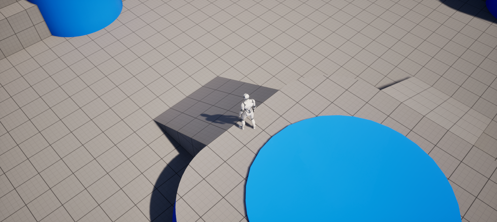
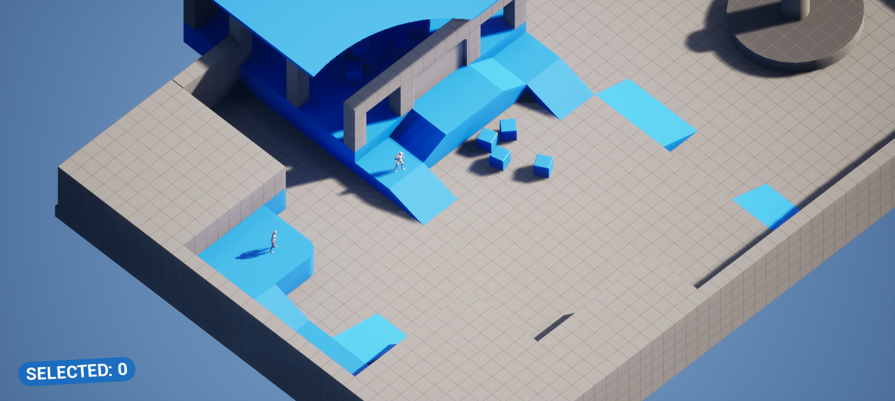
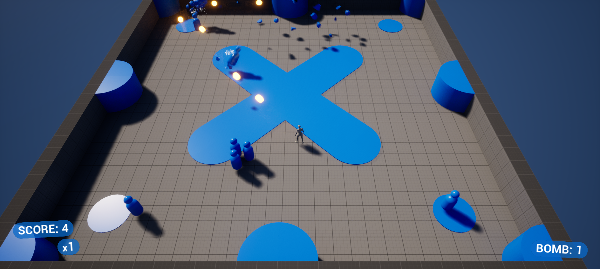

# top-down

The engine's Top Down template, point and click with the mouse or touch: its character, game mode and player controller are Rust classes. The engine's own version is Blueprint-only at its base; here its Blueprints are children of the Rust classes.

```bash
rusteal new MyGame --template top-down
```

From `TP_TopDown`, the engine template it is made of.

## Playing it

Open the project and press **Play**: click (or hold) / tap where the character should go.



## Its classes

The Rust classes are in `Rust/<crate>/src/`; their Blueprint children, under the engine template's names, are in `Content/`.

| Class | Parent | File |
|---|---|---|
| `TopDownCharacter` | `Character` | `src/character.rs` |
| `TopDownGameMode` | `GameModeBase` | `src/game_mode.rs` |
| `TopDownPlayerController` | `PlayerController` | `src/player_controller.rs` |

## Variants

Each variant is a project of its own: the template plus the variant, opening on the variant's level.

### strategy

A real-time strategy start: units selected with clicks, boxes and touches, sent along the navigation mesh by EnvQueries, and interacting with the units they reach.

```bash
rusteal new MyGame --template top-down --variant strategy
```

It opens `/Game/Variant_Strategy/LVL_Strategy`. To play: left click / drag selects units (Shift adds, double click selects all), right click sends them, WASD / right drag pans, wheel / Q E zoom.



Its own classes, next to the template's, in a module named after it:

| Class | Parent | File |
|---|---|---|
| `EnvQueryContextMoveGoal` | `EnvQueryContext_BlueprintBase` | `src/strategy/env_query.rs` |
| `StrategyGameMode` | `GameModeBase` | `src/strategy/game_mode.rs` |
| `StrategyHUD` | `HUD` | `src/strategy/hud.rs` |
| `StrategyPawn` | `Pawn` | `src/strategy/pawn.rs` |
| `StrategyPlayerController` | `PlayerController` | `src/strategy/player_controller.rs` |
| `StrategyTouchControls` | `UserWidget` | `src/strategy/touch_controls.rs` |
| `StrategyUI` | `UserWidget` | `src/strategy/ui.rs` |
| `StrategyUnit` | `Character` | `src/strategy/unit.rs` |

### twin-stick

A twin stick shooter: projectiles, dashes and area attacks against waves of enemies run by a StateTree, pickups and a combo score.

```bash
rusteal new MyGame --template top-down --variant twin-stick
```

It opens `/Game/Variant_TwinStick/LVL_TwinStick`. To play: WASD / left stick move, mouse / right stick aim, left click / RT shoot, Left Shift / LB dash, right click / LT area attack.



Its own classes, next to the template's, in a module named after it:

| Class | Parent | File |
|---|---|---|
| `TwinStickAIController` | `AIController` | `src/twin_stick/ai_controller.rs` |
| `TwinStickAoEAttack` | `Actor` | `src/twin_stick/aoe_attack.rs` |
| `TwinStickCharacter` | `Character` | `src/twin_stick/character.rs` |
| `TwinStickGameMode` | `GameModeBase` | `src/twin_stick/game_mode.rs` |
| `TwinStickNPC` | `Character` | `src/twin_stick/npc.rs` |
| `TwinStickNPCDestruction` | `Actor` | `src/twin_stick/npc_destruction.rs` |
| `TwinStickPickup` | `Actor` | `src/twin_stick/pickup.rs` |
| `TwinStickPlayerController` | `PlayerController` | `src/twin_stick/player_controller.rs` |
| `TwinStickProjectile` | `Actor` | `src/twin_stick/projectile.rs` |
| `TwinStickSpawner` | `Actor` | `src/twin_stick/spawner.rs` |
| `StateTreeGetPlayerTask` | `StateTreeTaskBlueprintBase` | `src/twin_stick/state_tree.rs` |
| `TwinStickUI` | `UserWidget` | `src/twin_stick/ui.rs` |

Recipes taken from it: [Point and click](../recipes/point_and_click.md), [AI](../recipes/ai.md), [Projectiles and weapons](../recipes/projectiles.md).
